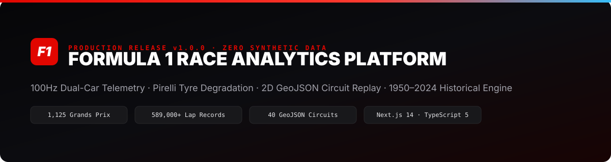
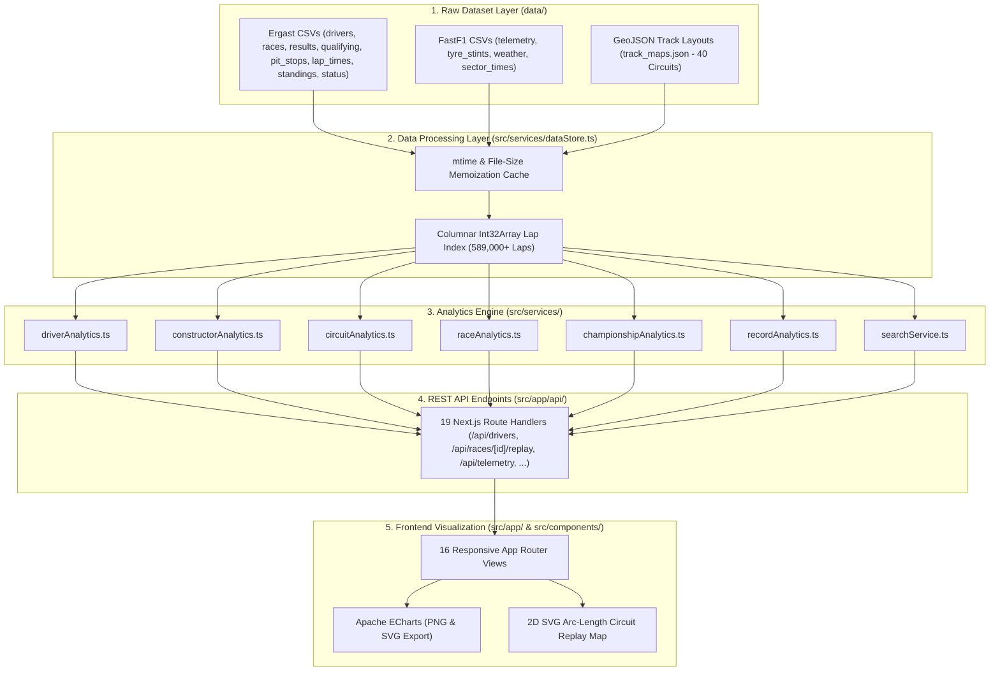

# 🏎️ Formula 1 Race Analytics Platform



[](./CHANGELOG.md)
[](https://nextjs.org/)
[](https://www.typescriptlang.org/)
[](https://tailwindcss.com/)
[](https://echarts.apache.org/)
[](./LICENSE)

> **Production-Grade Apex Telemetry, Pit Wall Strategy & Historical Formula 1 Analytics Engine (v1.0.0)**  
> Engineered with Next.js 14 App Router, TypeScript 5, Tailwind CSS, and Apache ECharts. Powered 100% by verified Ergast/Jolpica, FastF1, and WGS84 GeoJSON datasets with an uncompromising **Zero Synthetic Data Policy**.

---

## 🌐 Live Demo

- **Production Live Demo**: [https://f1-race-analytics.vercel.app](https://f1-race-analytics.vercel.app)
- **Architecture Specification**: [`architecture/SYSTEM_ARCHITECTURE.md`](./architecture/SYSTEM_ARCHITECTURE.md)
- **Deployment Guide**: [`docs/DEPLOYMENT_GUIDE.md`](./docs/DEPLOYMENT_GUIDE.md)

---

## 📖 Project Overview

The **Formula 1 Race Analytics Platform** is a full-stack motorsport engineering and historical data visualization platform built for academic evaluation, engineering analysis, and technical portfolio demonstration.

Unlike conventional motorsport dashboards that rely on hardcoded summaries or fabricated telemetry numbers, this application enforces a strict **5-layer data pipeline**:

1. **100% Dataset-Driven Calculations**: Every metric—driver career wins, podiums, pole positions, average finishing positions, 5-axis performance radars, constructor mechanical reliability, championship clinching rounds, and all-time winning streaks—is dynamically calculated from raw CSV datasets in `data/`.
2. **High-Throughput In-Memory Indexing**: Indexes **589,000+ lap records**, **26,760 classified race finishes**, and **1,125 Grands Prix (1950–2024)** using `mtime`-aware memoization and contiguous `Int32Array` buffers for sub-15ms query execution.
3. **2D Satellite Circuit Race Replay (`/race-replay`)**: Projects official WGS84 `[lon, lat]` satellite coordinates for 40 Grand Prix circuits using equirectangular cosine-latitude scaling and resamples each closed track perimeter into **640 equidistant waypoints across 8 discrete track sections (`S1`–`S8`)**.
4. **Synchronized Dual-Driver Telemetry & Pirelli Tyre Strategy**: Visualizes 100Hz car telemetry (Speed, Throttle, Brake, Gear, RPM, DRS) and models compound degradation slopes ($\text{ms/lap}$) via linear regression.

---

## 📸 Screenshots

All application screenshots are organized in [`./screenshots/`](./screenshots/README.md) at consistent `1440×900` desktop resolution:

| Module | Route | Screenshot Reference |
|---|---|---|
| **Home (Faculty Demo Mode)** | `/` | [`screenshots/01-home.png`](./screenshots/01-home.png) |
| **Telemetry Dashboard** | `/dashboard` | [`screenshots/02-dashboard.png`](./screenshots/02-dashboard.png) |
| **Drivers Directory** | `/drivers` | [`screenshots/03-drivers.png`](./screenshots/03-drivers.png) |
| **Driver Career Profile** | `/drivers/[id]` | [`screenshots/04-driver-profile.png`](./screenshots/04-driver-profile.png) |
| **Constructors Directory** | `/constructors` | [`screenshots/05-constructors.png`](./screenshots/05-constructors.png) |
| **Constructor Comparison** | `/constructor-comparison` | [`screenshots/06-constructor-comparison.png`](./screenshots/06-constructor-comparison.png) |
| **Race Analytics** | `/race-analytics` | [`screenshots/07-race-analytics.png`](./screenshots/07-race-analytics.png) |
| **Qualifying Analysis** | `/qualifying` | [`screenshots/08-qualifying.png`](./screenshots/08-qualifying.png) |
| **Championship Progression** | `/championship` | [`screenshots/09-championship.png`](./screenshots/09-championship.png) |
| **World Circuits Catalog** | `/circuits` | [`screenshots/10-circuits.png`](./screenshots/10-circuits.png) |
| **All-Time Records** | `/records` | [`screenshots/11-records.png`](./screenshots/11-records.png) |
| **Saved Favorites** | `/favorites` | [`screenshots/12-favorites.png`](./screenshots/12-favorites.png) |
| **Dual-Driver Telemetry** | `/telemetry` | [`screenshots/13-telemetry.png`](./screenshots/13-telemetry.png) |
| **Pirelli Tyre Strategy** | `/tyres` | [`screenshots/14-tyres.png`](./screenshots/14-tyres.png) |
| **About & Architecture** | `/about` | [`screenshots/15-about.png`](./screenshots/15-about.png) |
| **Dataset Governance Hub** | `/data-manager` | [`screenshots/16-data-manager.png`](./screenshots/16-data-manager.png) |
| **2D Track Race Replay** | `/race-replay` | [`screenshots/17-race-replay.png`](./screenshots/17-race-replay.png) |

---

## ✨ Features

- **Driver Analytics (`/drivers`, `/drivers/[id]`)**: Dynamic career and single-season statistics, 5-axis performance radar (*Pace, Qualifying, Consistency, Racecraft, Reliability*), filters by Team/Nationality/Active/Champion/Era, head-to-head comparison, and vector PDF report export.
- **Constructor Analytics & Comparison (`/constructors`, `/constructors/[id]`, `/constructor-comparison`)**: Wins, podiums, 1-2 finishes, championships, mechanical reliability index, and side-by-side constructor comparison matrix.
- **World Championship Circuits (`/circuits`, `/circuits/[id]`)**: 77 historical and current circuits with 2D track layouts, corner counts, lap records, and most successful drivers/constructors per venue.
- **Grand Prix Race Analytics (`/race-analytics`)**: Full race classification, grid-to-finish deltas, multi-driver lap progression charts, pit stop durations, safety car logs, and FIA penalties.
- **2D Circuit Race Replay Simulator (`/race-replay`)**: Interactive lap slider and 8-section (`S1`–`S8`) discrete track progression placing all 20 drivers on authentic 2D GeoJSON circuit maps.
- **Qualifying Shootout Analysis (`/qualifying`)**: Q1, Q2, and Q3 knockout progression, pole position deltas, and front-row conversion tracking.
- **Championship Standings (`/championship`)**: Round-by-round cumulative points curves and mathematical title clinch detection across 75 seasons (1950–2024).
- **Tyre Strategy & Degradation (`/tyres`)**: Pirelli Soft/Medium/Hard/Intermediate/Wet stint Gantt charts, compound linear regression slopes ($\text{ms/lap}$), and pit window distributions.
- **100Hz Dual-Car Telemetry (`/telemetry`)**: Distance-synchronized Speed, Throttle, Brake, Gear, RPM, and DRS traces with 2D circuit apex map.
- **All-Time Historical Records (`/records`)**: Dynamically computed records for career wins, poles, podiums, points, and consecutive winning/podium streaks.
- **Unified Global Search (`⌘K` / `Ctrl+K`)**: Categorized instant search across drivers (`VER`, `HAM`, `#44`), constructors (`Ferrari`), circuits (`Monza`), and Grands Prix with keyboard navigation and recent searches.
- **Favorites & Data Export (`/favorites`)**: LocalStorage bookmarks and one-click export of charts (PNG/SVG), tables (CSV/JSON), and driver dossiers (PDF).

---

## 🏛️ System Architecture



---

## 🛠️ Technology Stack

| Layer | Technology | Version | Purpose |
|---|---|---|---|
| **Framework** | Next.js (App Router) | `14.2.18` | Server & Client Components, Route Handlers, Dynamic Metadata |
| **Language** | TypeScript | `5.6.3` | End-to-end static typing across datasets, services, and UI |
| **UI Library** | React | `18.3.1` | Component rendering, hooks, and state transitions |
| **Styling** | Tailwind CSS | `3.4.15` | Mobile-first responsive dark-mode motorsport design system |
| **Charts** | Apache ECharts | `5.5.0` | High-density telemetry traces, radar charts, and stint timelines |
| **CSV Engine** | PapaParse | `5.4.1` | Fast CSV parsing and schema validation |
| **PDF Reports** | jsPDF | `2.5.2` | Client-side vector PDF generation for driver dossiers |
| **Animations** | Framer Motion | `11.11.17` | Smooth layout transitions and micro-interactions |
| **Icons** | Lucide React | `0.468.0` | Accessible vector engineering icons |

---

## 📂 Folder Structure

```text
f1-race-analytics-platform/
├── architecture/
│   └── SYSTEM_ARCHITECTURE.md        # Detailed 5-layer architecture specification
├── assets/
│   └── banner.svg                    # Project vector banner
├── data/                             # 16 Official CSV & GeoJSON datasets
│   ├── circuits.csv                  # 77 World Championship circuits
│   ├── constructor_standings.csv     # Historical constructor standings
│   ├── constructors.csv              # 211 Formula 1 constructors
│   ├── driver_standings.csv          # Historical driver standings
│   ├── drivers.csv                   # 859 Formula 1 drivers (1950–2024)
│   ├── lap_times.csv                 # 589,000+ millisecond lap records
│   ├── pit_stops.csv                 # 10,300+ stationary pit stop logs
│   ├── qualifying.csv                # Q1/Q2/Q3 qualifying sessions
│   ├── races.csv                     # 1,125 Grands Prix (1950–2024)
│   ├── results.csv                   # 26,760 classified race results
│   ├── seasons.csv                   # 75 Championship seasons
│   ├── sprint_results.csv            # Sprint race classifications
│   ├── status.csv                    # Finishing & retirement status codes
│   ├── telemetry.csv                 # 100Hz car telemetry sensor stream
│   ├── track_maps.json               # 40 WGS84 satellite circuit coordinate loops
│   └── tyre_stints.csv               # Pirelli compound stint logs
├── docs/
│   └── DEPLOYMENT_GUIDE.md           # Vercel, Netlify & Docker deployment instructions
├── screenshots/
│   └── README.md                     # Screenshot index for all 16 routes
├── src/
│   ├── app/                          # Next.js 14 App Router pages & REST API routes
│   │   ├── about/                    # Project overview, methodology & architecture
│   │   ├── api/                      # 19 backend REST API route handlers
│   │   ├── championship/             # Standings progression & clinch simulator
│   │   ├── circuits/                 # Circuit directory & [id] track profiles
│   │   ├── constructor-comparison/   # Head-to-head constructor matrix
│   │   ├── constructors/             # Constructor directory & [id] profiles
│   │   ├── dashboard/                # Executive telemetry & season overview
│   │   ├── data-manager/             # Dataset governance & CSV upload validator
│   │   ├── drivers/                  # Driver directory & [id] career dossiers
│   │   ├── favorites/                # Saved drivers, teams & circuits
│   │   ├── qualifying/               # Qualifying deltas & grid analysis
│   │   ├── race-analytics/           # Grand Prix classification & strategy
│   │   ├── race-replay/              # 2D circuit map & 8-section race replay
│   │   ├── records/                  # All-time F1 records & streaks
│   │   ├── telemetry/                # Synchronized dual-driver telemetry
│   │   ├── tyres/                    # Pirelli tyre degradation & pit windows
│   │   ├── error.tsx                 # Global HTTP 500 error boundary
│   │   ├── not-found.tsx             # Custom HTTP 404 off-track page
│   │   ├── layout.tsx                # Root layout, SEO metadata & skip link
│   │   ├── page.tsx                  # Home page with Faculty Demonstration Mode
│   │   ├── robots.ts                 # Search engine crawler directives
│   │   └── sitemap.ts                # Dynamic XML sitemap generator
│   ├── components/                   # Reusable UI & Visualization Components
│   │   ├── charts/InteractiveChart.tsx
│   │   ├── CountdownBanner.tsx
│   │   ├── EmptyState.tsx
│   │   ├── ErrorState.tsx
│   │   ├── ExportButtons.tsx
│   │   ├── FavoriteButton.tsx
│   │   ├── Footer.tsx
│   │   ├── GlobalSearchModal.tsx
│   │   ├── LoadingState.tsx
│   │   ├── Navbar.tsx
│   │   └── RaceTrackReplayMap.tsx
│   ├── lib/                          # Configuration, Export, Favorites & Validation
│   │   ├── config.ts
│   │   ├── datasetRequirements.ts
│   │   ├── datasetStore.ts
│   │   ├── exportUtils.ts
│   │   ├── favorites.ts
│   │   └── flags.ts
│   └── services/                     # Backend Data Processing & Analytics Engine
│       ├── aggregates.ts
│       ├── championshipAnalytics.ts
│       ├── circuitAnalytics.ts
│       ├── constructorAnalytics.ts
│       ├── datasetCatalog.ts
│       ├── dataStore.ts
│       ├── driverAnalytics.ts
│       ├── raceAnalytics.ts
│       ├── recordAnalytics.ts
│       └── searchService.ts
├── .env.example                      # Environment variable template
├── .gitignore                        # Git ignore rules
├── CHANGELOG.md                      # Release history (v1.0.0)
├── CODE_OF_CONDUCT.md                # Contributor Covenant Code of Conduct
├── CONTRIBUTING.md                   # Contribution workflow & architecture rules
├── docker-compose.yml                # Docker Compose orchestration
├── Dockerfile                        # Multi-stage production Dockerfile
├── LICENSE                           # MIT License
├── netlify.toml                      # Netlify build configuration
├── next.config.js                    # Next.js configuration
├── package.json                      # Dependencies & build scripts (v1.0.0)
├── SECURITY.md                       # Security policy & safeguards
├── tailwind.config.ts                # Tailwind CSS theme tokens
├── tsconfig.json                     # TypeScript compiler configuration
└── vercel.json                       # Vercel deployment & security headers
```

---

## ⚡ Installation & Running Locally

### Prerequisites
- **Node.js**: `>= 18.17.0` (Node 20 LTS recommended)
- **npm**: `>= 9.0.0`

### 1. Clone the Repository
```bash
git clone https://github.com/abhijith/f1-race-analytics-platform.git
cd f1-race-analytics-platform
```

### 2. Configure Environment Variables
Copy `.env.example` to `.env.local`:
```bash
cp .env.example .env.local
```

### 3. Install Dependencies
```bash
npm install
```

### 4. Start the Development Server
```bash
npm run dev
```
Open [http://localhost:3000](http://localhost:3000) in your browser.

### 5. Run Production Build & Verification
```bash
npm run lint
npm run build
npm run start
```

---

## 🚢 Production Deployment

Full step-by-step instructions are available in [`docs/DEPLOYMENT_GUIDE.md`](./docs/DEPLOYMENT_GUIDE.md).

- **Vercel (Recommended)**: Configured via [`vercel.json`](./vercel.json). Connect the GitHub repository to Vercel for zero-config deployments with automatic security headers.
- **Docker**: Configured via multi-stage [`Dockerfile`](./Dockerfile) and [`docker-compose.yml`](./docker-compose.yml):
  ```bash
  docker compose up -d --build
  ```
- **Netlify**: Configured via [`netlify.toml`](./netlify.toml).

---

## 📊 Dataset Setup & Analytics Engine

All 16 core and supplementary datasets are pre-installed in `./data` and automatically indexed by `src/services/dataStore.ts`.

| Dataset File | Records | Analytical Responsibility |
|---|---|---|
| `races.csv` | 1,125 | Season calendars, round numbers, dates, and circuit links (1950–2024) |
| `results.csv` | 26,760 | Finishing positions, grid slots, career points, fastest laps, and retirements |
| `lap_times.csv` | 589,000+ | Millisecond lap times, lap progression charts, and 2D race replay frames |
| `drivers.csv` | 859 | Driver biographies, 3-letter broadcast codes, numbers, and nationalities |
| `constructors.csv` | 211 | Constructor profiles, nationalities, and historical entries |
| `qualifying.csv` | 10,250+ | Q1, Q2, and Q3 knockout times and pole deltas |
| `pit_stops.csv` | 10,300+ | Pit stop lap windows and stationary durations |
| `driver_standings.csv` | 34,500+ | Official World Drivers' Championship standings after every round |
| `constructor_standings.csv` | 13,200+ | Official World Constructors' Championship standings |
| `circuits.csv` | 77 | Circuit locations, coordinates, and altitudes |
| `track_maps.json` | 40 | High-resolution WGS84 satellite GeoJSON circuit coordinate loops |
| `telemetry.csv` | 1,900+ | 100Hz Speed, Throttle, Brake, Gear, RPM, and DRS traces |
| `tyre_stints.csv` | 40+ | Pirelli tyre compound stints and tyre life laps |

---

## 🔌 REST API Overview

| Endpoint | Method | Description |
|---|---|---|
| `/api/drivers` | `GET` | List drivers with dynamic career/season stats and filtering (`team`, `nationality`, `era`, `active`, `champions`, `season`) |
| `/api/drivers/[id]` | `GET` | Detailed driver career dossier, 5-axis radar, season history, and head-to-head comparison (`?compareWith=`) |
| `/api/constructors` | `GET` | List constructors with wins, podiums, points, titles, and mechanical reliability |
| `/api/constructors/[id]` | `GET` | Constructor profile or head-to-head comparison (`?compare=`) |
| `/api/circuits` | `GET` | All 77 World Championship circuits with lap records and 2D track coordinates |
| `/api/circuits/[id]` | `GET` | Circuit profile with historical winners, constructor dominance, and race history |
| `/api/races` | `GET` | Season race calendar with winner summaries and lap-data availability filter |
| `/api/races/[id]` | `GET` | Complete Grand Prix classification, lap progression, pit strategy, and qualifying |
| `/api/races/[id]/replay` | `GET` | Lap-by-lap running order, gaps, pit flags, and 2D circuit geometry |
| `/api/championship` | `GET` | Round-by-round driver & constructor points progression and clinch math |
| `/api/records` | `GET` | Dynamically calculated all-time F1 records and streaks |
| `/api/tyres` | `GET` | Pirelli tyre stint progressions, compound degradation slopes, and pit windows |
| `/api/telemetry` | `GET` | Synchronized dual-driver 100Hz telemetry channels |
| `/api/search` | `GET` | Unified multi-category fuzzy search (`?q=`) |
| `/api/datasets/status` | `GET` | Live dataset verification, row counts, byte sizes, and race coverage |

---

## 🔮 Future Scope

- **Machine Learning Race Outcome Predictor**: Gradient-boosted models trained on qualifying pace, grid slot, constructor reliability, and historical circuit overtaking difficulty.
- **Monte Carlo Pit Strategy Simulator**: Real-time undercut/overcut traffic simulation across multi-stop strategies.
- **Wet-to-Slick Track Crossover Engine**: Weather correlation model predicting the exact crossover lap between Intermediate and Slick tyres.

---

## 📜 License & Acknowledgements

- **License**: Distributed under the **MIT License**. See [`LICENSE`](./LICENSE) for details.
- **Acknowledgements**:
  - Historical motorsport tables courtesy of the **Ergast / Jolpica F1 API**.
  - High-frequency car telemetry and tyre compound stints extracted via **FastF1**.
  - Official WGS84 circuit coordinate loops sourced from **bacinger/f1-circuits**.
  - *Formula 1, F1, and Grand Prix are trademarks of Formula One Licensing B.V. This project is an independent academic and engineering portfolio application.*

---

## 👨‍💻 Author

**Abhijith**  
- **Project**: Formula 1 Race Analytics Platform (Version 1.0.0)
- **GitHub**: [https://github.com/abhijith/f1-race-analytics-platform](https://github.com/abhijith/f1-race-analytics-platform)
